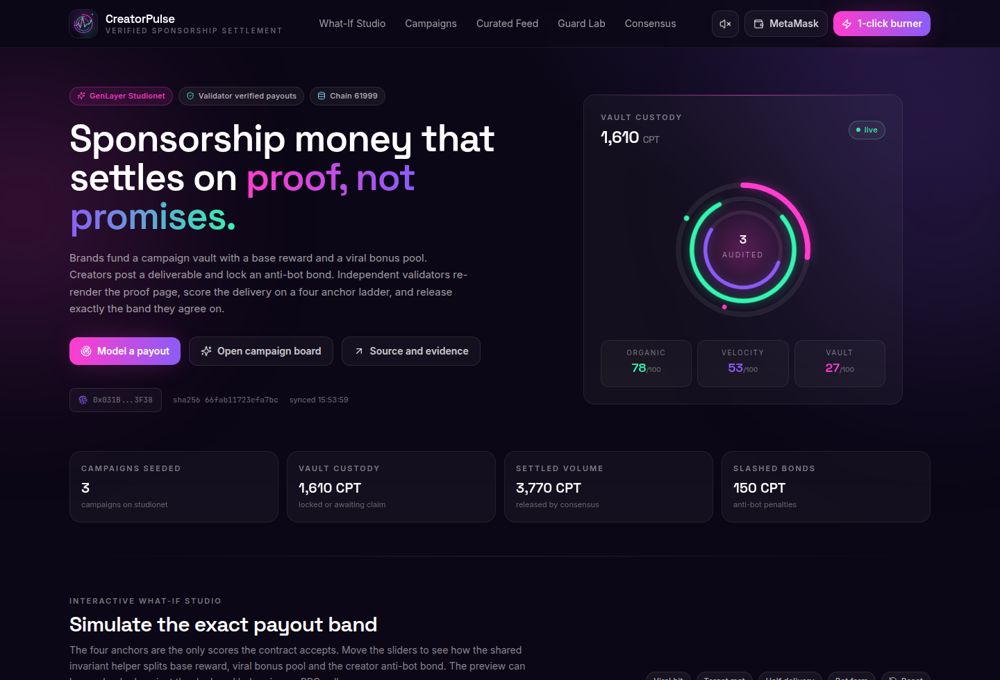
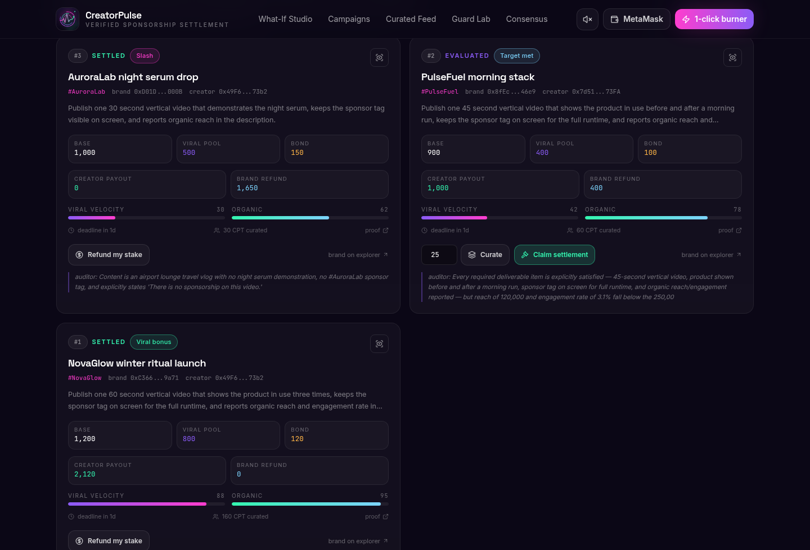
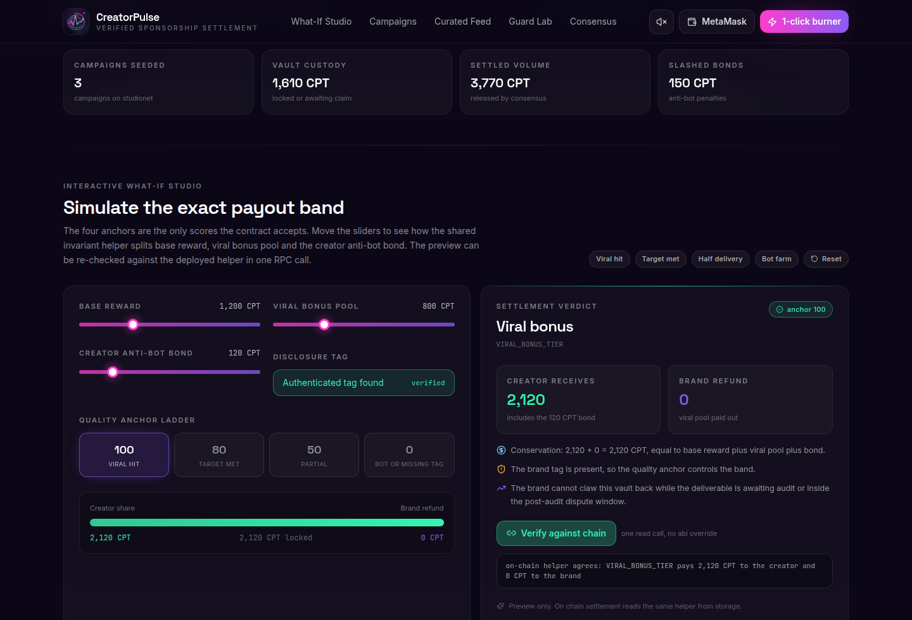
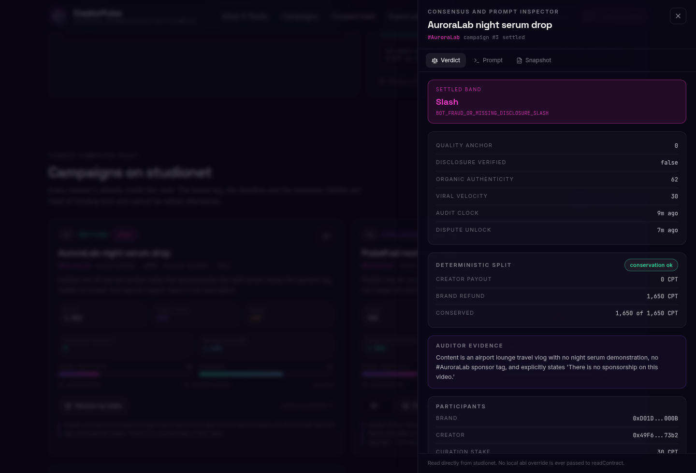

# CreatorPulse

**AI verified brand sponsorship and creator campaign KPI settlement on GenLayer.**

CreatorPulse is a working settlement hub for the creator economy. A brand funds a campaign vault in
CPT, the campaign token. A creator accepts the brief, locks an anti-bot bond, and publishes a
deliverable. Independent GenLayer validators re-render the submitted proof page, verify that the
authenticated brand tag is really disclosed, score the delivery on a four anchor ladder, and agree
exactly on one settlement band. The vault then pays out through a single deterministic helper.

No owner key can score a campaign. No brand can unilaterally approve a payout, slash a creator, or
claw back the viral bonus pool while an audit is pending. The only path from a submitted deliverable
to money moving is live validator consensus.

- Live app: https://richeroveis.github.io/creator-pulse/
- Repository: https://github.com/richeroveis/creator-pulse
- Contract: `contracts/creator_pulse.py`
- Evidence: `evidence/studionet_deployment.json`
- Tag: `studionet-v1`

---

## Why this exists

Creator sponsorships break down over three questions:

1. Did the creator actually deliver what the brief promised?
2. Was the sponsor disclosure really shown, or only claimed in a caption?
3. Is the engagement organic, or bought?

Today those questions are answered in a private spreadsheet by whoever holds the invoice. Creators
wait months for a discretionary decision. Brands overpay for bot traffic. Affiliate managers have no
auditable record.

CreatorPulse turns the decision into a consensus object. Validators fetch the same public proof page,
run the same ladder, and must agree on three fields before a single CPT leaves custody. The payout
band is derived from those fields by one shared pure function, so a validator cannot "agree" on an
anchor and still have the contract pay a different amount.

---

## The steward red lines

### 1. Zero owner, admin or brand bypasses

There is no `owner`, `admin`, `governor` or `operator` storage field, and no public method that can
set a score, approve a payout or slash a creator. A campaign can only be evaluated through
`verify_campaign_deliverable_live`, which runs `gl.nondet.web.render` and
`gl.eq_principle.prompt_comparative`. The test suite parses the contract AST and fails if any such
role or method ever appears.

### 2. A really funded vault, a creator bond and a maximum liability lock

- CPT lives in `token_balances: TreeMap[Address, u256]` and `vault_custody_balance: u256`.
- `create_campaign` debits `base_reward + viral_bonus_pool` from the brand and locks it. That sum is
  the maximum potential liability of the campaign.
- `accept_and_submit_deliverable` debits `required_creator_bond` from the creator into custody.
- `curate_deliverable` locks community CPT behind a deliverable.
- **PAPITO lock:** the brand cannot withdraw the base reward or the viral pool while the campaign is
  still accepting submissions, while a deliverable is awaiting audit, or during the post-audit
  dispute window. `withdraw_campaign_liquidity` is the only reclaim path and it reverts with
  `PAPITO_LIABILITY_LOCK` in all three states.

### 3. A discrete band decided inside consensus

`verify_campaign_deliverable_live` snapshots every settlement input into plain locals before the non
deterministic call. Inside consensus it renders the proof page, rejects a missing authenticated tag,
and asks the model for exactly one of four anchors. Parsing is fail-closed: malformed JSON, a missing
anchor, a non numeric anchor or an out of range anchor reverts the transaction instead of picking a
friendly default. `prompt_comparative` requires exact agreement on `campaign_band`, `quality_anchor`
and `disclosure_verified`.

### 4. One coherent invariant helper

`_compute_campaign_band` is the single source of truth for every split. The auditor, the settlement
gate and the simulator preview view all call it. `_sync_top_curated_campaign` is the single source of
truth for the curated ranking, and settlement re-syncs it so a settled campaign can never stay on the
board. Settlement requires `evaluated == True` and a closed dispute window.

---

## Settlement bands

Let `B` be the base reward, `V` the viral bonus pool and `D` the creator bond. The vault always holds
`B + V` after funding and `B + V + D` after submission.

| Band | Trigger | Creator receives | Brand receives |
| --- | --- | --- | --- |
| `VIRAL_BONUS_TIER` | anchor 100 and disclosure verified | `B + V + D` | `0` |
| `TARGET_MET_TIER` | anchor 80 and disclosure verified | `B + D` | `V` |
| `PARTIAL_DELIVERY_TIER` | anchor 50 and disclosure verified | `floor(B/2) + D` | `B - floor(B/2) + V` |
| `BOT_FRAUD_OR_MISSING_DISCLOSURE_SLASH` | anchor 0 or disclosure missing | `0` | `B + V + D` |

Every row satisfies `creator_payout + brand_refund = B + V + D`, which is asserted in the contract,
in the direct tests, and in the live deployment evidence.

Anchors are snapped **down** to the nearest rung. A model answer of 79 becomes 50, never 80. A missing
tag forces anchor 0 regardless of what the model said.

---

## Contract surface

| Method | Type | Purpose |
| --- | --- | --- |
| `faucet_or_deposit(amount)` | write | Capped test faucet, 400,000 CPT lifetime per account |
| `transfer_tokens(to, amount)` | write | CPT transfer with `str` or `Address` coercion |
| `create_campaign(...)` | write | Fund a vault and lock the maximum liability |
| `accept_and_submit_deliverable(id, url)` | write | Lock the creator bond and submit a proof URL |
| `curate_deliverable(id, stake)` | write | Stake CPT behind a submitted deliverable |
| `verify_campaign_deliverable_live(id)` | write | Consensus audit, band and split |
| `claim_campaign_settlement(id)` | write | Release the band after the dispute window |
| `claim_curation_refund(id)` | write | Curator pull refund after settlement |
| `withdraw_campaign_liquidity(id)` | write | Brand reclaim, blocked by the PAPITO lock |
| `get_dashboard(limit)` | view | Stats, campaigns, feed and config in one call |
| `get_campaign(id)` | view | Full campaign snapshot |
| `get_feed(limit)` | view | Curated ranking of evaluated campaigns |
| `get_campaign_band_preview(...)` | view | The shared helper, exposed for the simulator |
| `check_vault_invariants()` | view | Vault equals escrow plus unrefunded curation |
| `get_config()` | view | Guardrail constants and the equivalence principle |
| `get_stats()` | view | Vault, volume, slashes, audits |

Other views: `get_campaign_count`, `get_token_balance`, `get_my_balance`, `get_curator_stake`.

---

## Invariants

- `vault_custody_balance == sum(active campaign escrow) + sum(unrefunded curation stakes)`
- `creator_payout + brand_refund == base_reward + viral_bonus_pool + required_creator_bond`
- A settled or cancelled campaign contributes zero escrow
- A campaign cannot be audited twice, settled twice, or curated after settlement
- A brand cannot submit its own campaign, and neither brand nor creator can curate it
- The faucet is capped per account, rewards, bonds and curation stakes all have floors and ceilings, and
  every deadline has a minimum and maximum window

## Lifecycle and liveness

| State | Allowed action | Caller | Next state | Funds movement |
| --- | --- | --- | --- | --- |
| `OPEN` | `accept_and_submit_deliverable` before the deadline | any account except the brand | `SUBMITTED` | creator bond `D` into custody |
| `OPEN` | `withdraw_campaign_liquidity` at or after the deadline | the funding brand | `CANCELLED` | `B + V` refunded to the brand |
| `SUBMITTED` | `verify_campaign_deliverable_live` | anyone (permissionless keeper) | `EVALUATED` | none, the band is stored |
| `SUBMITTED` or `EVALUATED` | `curate_deliverable` before settlement | any account except brand and creator | unchanged | stake `S` into custody |
| `EVALUATED` | `claim_campaign_settlement` after the dispute unlock | anyone (permissionless keeper) | `SETTLED` | `creator_payout + brand_refund` released |
| `SETTLED` | `claim_curation_refund` | the curator that staked | `SETTLED` | `S` returned to that curator |

No state can strand funds. An abandoned `OPEN` campaign returns to the brand after the deadline, a
`SUBMITTED` campaign can be audited by anyone, and an `EVALUATED` campaign can be claimed by anyone once
the dispute window closes. Settlement and cancellation are mutually exclusive by status and by strictly
complementary timestamp comparisons: submissions require `now < deadline`, reclaim requires
`now >= deadline`, and claims require `now >= unlock`.

---

## Architecture

```text
Brand wallet                       Creator wallet                  Curator wallets
     |                                  |                               |
     | create_campaign                  | accept_and_submit             | curate_deliverable
     v                                  v                               v
+--------------------------------------------------------------------------------------+
|                           CreatorPulse intelligent contract                          |
|                                                                                      |
|  token_balances: TreeMap[Address, u256]        vault_custody_balance: u256          |
|  campaigns: TreeMap[str, Campaign]             curation_stakes: TreeMap[str, u256]  |
|                                                                                      |
|  verify_campaign_deliverable_live                                                    |
|    1. snapshot storage into plain locals                                             |
|    2. gl.nondet.web.render(proof_url, mode="text")                                   |
|    3. require the authenticated brand tag                                            |
|    4. gl.nondet.exec_prompt(json) -> one of 0, 50, 80, 100                           |
|    5. gl.eq_principle.prompt_comparative on band, anchor, disclosure                 |
|    6. _compute_campaign_band -> creator payout, brand refund                         |
|                                                                                      |
|  claim_campaign_settlement -> credit creator and brand, release escrow               |
+--------------------------------------------------------------------------------------+
                                  |
                                  v
                    studionet validators (5 per transaction)
```

The frontend is a static React bundle. It never computes a settlement for money. The What-If Studio
mirrors the helper for illustration only, and its "Verify against chain" button reads
`get_campaign_band_preview` from the deployed contract to prove the mirror agrees.

---

## Repository layout

```text
contracts/creator_pulse.py          intelligent contract, pinned runner on line 1
tests/conftest.py                   Windows unlink workaround plus fixtures
tests/test_creator_pulse_direct.py  106 direct tests, all passing
scripts/deploy_studionet.py         idempotent live deployment and seeding
scripts/verify_identity.py          4-way sha256 identity check
tools/make_logo.py                  procedural 512x512 logo generator
tools/generate_soundtrack.py        synthesized demo soundtrack
frontend/                           React, TypeScript, Vite, Tailwind, genlayer-js
frontend/public/proofs/             static proof pages fetched by validators
evidence/studionet_deployment.json  deploy address, tx table, state and hashes
docs/                               logo, demo video, evidence notes
```

---

## Quick start

```bash
python3 -m venv .venv
. .venv/bin/activate
pip install -r requirements.txt

genvm-lint check contracts/creator_pulse.py
pytest tests/ -q

cd frontend
npm install
npm run build
npm run dev
```

Live deployment (needs `GENLAYER_PRIVATE_KEY` in this project's own `.env`):

```bash
.venv/bin/python scripts/deploy_studionet.py --full
.venv/bin/python scripts/verify_identity.py
```

The deploy script checkpoints every step in `evidence/_deploy_state.json` (gitignored) so a network
failure resumes instead of duplicating transactions. Burner keys for the demo brands, creators and
curators live only in that ignored file.

---

## Live studionet evidence

<!-- DEPLOYMENT_EVIDENCE_START -->
### Deployment identity

| Field | Value |
| --- | --- |
| Network | studionet, chain id 61999 |
| Contract | [`0x031B8ed9391b81fd89107B231F9573bD699e3F38`](https://explorer-studio.genlayer.com/address/0x031B8ed9391b81fd89107B231F9573bD699e3F38) |
| Deploy transaction | [`0xa0d3b9ddfb9ae63a9c102f1b32890f67b48925c1e97c21ba4ad941c20280abd4`](https://explorer-studio.genlayer.com/tx/0xa0d3b9ddfb9ae63a9c102f1b32890f67b48925c1e97c21ba4ad941c20280abd4) |
| Contract file sha256 | `66fab11723efa7bc3603a8537c2f98003649fe9339b2397829146539df1c4d65` |
| Deployed code sha256 | `66fab11723efa7bc3603a8537c2f98003649fe9339b2397829146539df1c4d65` |
| Runner | `# { "Depends": "py-genlayer:1jb45aa8ynh2a9c9xn3b7qqh8sm5q93hwfp7jqmwsfhh8jpz09h6" }` |

Four independent places carry the same code hash: `contracts/creator_pulse.py` on disk,
`evidence/studionet_deployment.json`, `frontend/src/config.ts` and this README. Run
`python scripts/verify_identity.py` to re-check all four, plus the address that appears in the
evidence file and the frontend.

### Transaction table

Every row below was polled to `FINALIZED` and read back through the explorer RPC. Guard probes are
expected to finish with `FINISHED_WITH_ERROR`; the payload column in the evidence file records the
exact revert string.

| Step | Transaction | Status | Result | Execution | Votes |
| --- | --- | --- | --- | --- | --- |
| `faucet:brand_nova` | [0xcfa3dbded8](https://explorer-studio.genlayer.com/tx/0xcfa3dbded8b194b7421e1f1172a0c7abd563fd7f90ba1b5a0d1730a273bc5b1c) | FINALIZED | MAJORITY_AGREE | SUCCESS | 3 agree / 0 disagree |
| `faucet:brand_pulse` | [0x51f60c5389](https://explorer-studio.genlayer.com/tx/0x51f60c5389b5451ed5bdbacfb5da529da87b6811c48e0d0286a8490492c805a2) | FINALIZED | MAJORITY_AGREE | SUCCESS | 5 agree / 0 disagree |
| `faucet:brand_aurora` | [0xb9d2b69d69](https://explorer-studio.genlayer.com/tx/0xb9d2b69d694cd71d44a1bc014fa87e8c2aeabc695a03c35165342d02dbd389cc) | FINALIZED | MAJORITY_AGREE | SUCCESS | 3 agree / 0 disagree |
| `faucet:creator_mira` | [0x6ef665b5be](https://explorer-studio.genlayer.com/tx/0x6ef665b5be71a4d5672506d6251364e08c52ae384fd3486abf012b329d7c489c) | FINALIZED | MAJORITY_AGREE | SUCCESS | 5 agree / 0 disagree |
| `faucet:creator_jonas` | [0x47b4350953](https://explorer-studio.genlayer.com/tx/0x47b435095386dc53c3f43567398e796bdf5d6fdb59107859b35f291c9afa7a07) | FINALIZED | MAJORITY_AGREE | SUCCESS | 3 agree / 0 disagree |
| `faucet:curator_lin` | [0xf656aec2f2](https://explorer-studio.genlayer.com/tx/0xf656aec2f27d39fb9ecda7c5fa6728b251f3e158676ae8afd0416941c0b73628) | FINALIZED | MAJORITY_AGREE | SUCCESS | 5 agree / 0 disagree |
| `faucet:curator_ada` | [0xc1dd643806](https://explorer-studio.genlayer.com/tx/0xc1dd643806746882cd338616708f81332dd374b280fad5f2b8eec5d2b116a052) | FINALIZED | MAJORITY_AGREE | SUCCESS | 5 agree / 0 disagree |
| `create:1` | [0x5b1f82cee8](https://explorer-studio.genlayer.com/tx/0x5b1f82cee8746668deb44e98defdc19f5c18b2616612eb67e613696c1654349b) | FINALIZED | MAJORITY_AGREE | SUCCESS | 5 agree / 0 disagree |
| `create:2` | [0x67452884a7](https://explorer-studio.genlayer.com/tx/0x67452884a77efb2c997d7b82b3ba4f5c9546f8b09831f4fb0901bbde8c1e7fbf) | FINALIZED | MAJORITY_AGREE | SUCCESS | 5 agree / 0 disagree |
| `create:3` | [0xdd7ed0be9c](https://explorer-studio.genlayer.com/tx/0xdd7ed0be9c097a4b3bd94f568d6b6181d6f88f116a91d259bf1d6fe9d5d425ab) | FINALIZED | MAJORITY_AGREE | SUCCESS | 5 agree / 0 disagree |
| `submit:1` | [0x3f13ba9dfa](https://explorer-studio.genlayer.com/tx/0x3f13ba9dfa79da65a28b95ff72ff3c8043ae75cad46b60b73cda9fd346533acd) | FINALIZED | MAJORITY_AGREE | SUCCESS | 3 agree / 0 disagree |
| `submit:2` | [0x593daa3e1f](https://explorer-studio.genlayer.com/tx/0x593daa3e1f84ff47ba62770a5cffbf9abb12b15f3c5f574722bfacb04972c534) | FINALIZED | MAJORITY_AGREE | SUCCESS | 3 agree / 0 disagree |
| `submit:3` | [0x7036384849](https://explorer-studio.genlayer.com/tx/0x7036384849186144ee1684b1423e9df6ac9f4f58d155d0e9ab2cf71509a337a8) | FINALIZED | MAJORITY_AGREE | SUCCESS | 5 agree / 0 disagree |
| `curate:1` | [0x36f7ea8903](https://explorer-studio.genlayer.com/tx/0x36f7ea8903c5ef3f51eeec402822e7d91bac0ff645f0792b28ec9c22ce3cccc0) | FINALIZED | MAJORITY_AGREE | SUCCESS | 3 agree / 0 disagree |
| `curate:2` | [0x5e8c594497](https://explorer-studio.genlayer.com/tx/0x5e8c594497e2010ff3cf3849832c4cb665f77fea9a8db6a4ec006faac1060d53) | FINALIZED | MAJORITY_AGREE | SUCCESS | 3 agree / 0 disagree |
| `curate:3` | [0xd82fe1d620](https://explorer-studio.genlayer.com/tx/0xd82fe1d620bafa4246ad2342b71e8222a83905a829ec8255f9a36e9af1c55402) | FINALIZED | MAJORITY_AGREE | SUCCESS | 3 agree / 0 disagree |
| `curate:4` | [0x89f40b9334](https://explorer-studio.genlayer.com/tx/0x89f40b9334cdb312090a279c3646fbf7e8b37acac37c9b938ab1876590b839c1) | FINALIZED | MAJORITY_AGREE | SUCCESS | 3 agree / 0 disagree |
| `guard:clawback-submitted` | [0x150977f14d](https://explorer-studio.genlayer.com/tx/0x150977f14dabc3b8ff0b95cc0bdb1fdb107c49e692922b7382f6f854123353d3) | FINALIZED | MAJORITY_AGREE | FINISHED_WITH_ERROR | 3 agree / 0 disagree |
| `audit:1` | [0x9b1bccaa4a](https://explorer-studio.genlayer.com/tx/0x9b1bccaa4aacface3eb63752c21578cd1f17d016b2d4b792c1f71567890c7e9c) | FINALIZED | MAJORITY_AGREE | SUCCESS | 3 agree / 0 disagree |
| `audit:2` | [0x065ade2b16](https://explorer-studio.genlayer.com/tx/0x065ade2b16dc4c76fcb318ec7990b9cc4ea6aa4ad5f5db3b5a74a0725adee60a) | FINALIZED | MAJORITY_AGREE | SUCCESS | 3 agree / 1 disagree |
| `audit:3` | [0x1806400aa3](https://explorer-studio.genlayer.com/tx/0x1806400aa312fad513f80c6055cf65029e06566e0e0b50bb8022ee0ef8ec6714) | FINALIZED | MAJORITY_AGREE | SUCCESS | 3 agree / 0 disagree |
| `guard:clawback-evaluated` | [0x0e94e36001](https://explorer-studio.genlayer.com/tx/0x0e94e360017efb384f58cd32732d99249a796c75c21baaa2e07b09cf11635078) | FINALIZED | MAJORITY_AGREE | FINISHED_WITH_ERROR | 3 agree / 0 disagree |
| `settle:1` | [0x858d32683e](https://explorer-studio.genlayer.com/tx/0x858d32683e99d8516e5ca569f7a4a7d007e97c134f28ca66d7a373a5a5ccf647) | FINALIZED | MAJORITY_AGREE | SUCCESS | 3 agree / 0 disagree |
| `settle:3` | [0xd3bbc7dafd](https://explorer-studio.genlayer.com/tx/0xd3bbc7dafd1f80bff518d185e0343d2f297794290367873a186537727668607f) | FINALIZED | MAJORITY_AGREE | SUCCESS | 5 agree / 0 disagree |
| `refund:curation-1` | [0xad9be373ef](https://explorer-studio.genlayer.com/tx/0xad9be373efca9c11338ffed9b3540dbcbc03f52e5735c9116170f8200669666f) | FINALIZED | MAJORITY_AGREE | SUCCESS | 3 agree / 0 disagree |
| `guard:curate-after-settlement` | [0x64d911c685](https://explorer-studio.genlayer.com/tx/0x64d911c685435cadbcd2bf8f280d074703be76d950f356fd0fcd385f25c7bc11) | FINALIZED | MAJORITY_AGREE | FINISHED_WITH_ERROR | 3 agree / 0 disagree |
| `guard:transfer-overdraw` | [0x3874ece506](https://explorer-studio.genlayer.com/tx/0x3874ece506f915bec863448686d9bd1116933e71c6583959288a7b252904bbd6) | FINALIZED | MAJORITY_AGREE | FINISHED_WITH_ERROR | 3 agree / 0 disagree |

### Final campaign state

| Id | Campaign | Band | Anchor | Creator CPT | Brand CPT | State |
| --- | --- | --- | --- | --- | --- | --- |
| 3 | AuroraLab night serum drop | `BOT_FRAUD_OR_MISSING_DISCLOSURE_SLASH` | 0 | 0 | 1650 | SETTLED |
| 2 | PulseFuel morning stack | `TARGET_MET_TIER` | 80 | 1000 | 400 | EVALUATED |
| 1 | NovaGlow winter ritual launch | `VIRAL_BONUS_TIER` | 100 | 2120 | 0 | SETTLED |

Vault invariant at the end of the run:
`vault 1610 CPT == escrow
1400 + curation
210`, drift
`0`.

The raw machine readable record, including every vote tally, payload and final balance, lives in
[`evidence/studionet_deployment.json`](evidence/studionet_deployment.json).

<!-- DEPLOYMENT_EVIDENCE_END -->

---

## Security model

| Threat | Control |
| --- | --- |
| Brand tries to score or approve its own campaign | No privileged write path exists; scoring only through consensus |
| Brand pulls the viral pool during an audit | `PAPITO_LIABILITY_LOCK` revert in open, submitted and post-audit states |
| Creator fakes the disclosure in a caption | The tag must appear in the rendered page text, checked deterministically |
| Creator buys engagement | Anchor 0 or a bot signal forces the slash band and burns the bond |
| Model returns malformed JSON to force a payout | Fail-closed parsing reverts instead of defaulting |
| Prompt injection inside the proof page | Content is sanitized and delimited, the disclosure gate is deterministic and sits outside the model, and every validator re-runs the audit |
| Leader picks a self-serving band | `prompt_comparative` demands exact agreement on three settlement fields |
| Validator reads different state | All inputs are snapshotted before the non deterministic call |
| Settlement pays more than custody | Conservation is asserted before any credit and checked by a view |
| Curator games the feed after settlement | Curation reverts once settled, and settlement re-syncs the ranking |
| Replay of a claim | `settled` flag plus state machine block a second release |
| Brand self-dealing | Brand cannot submit its own campaign, neither party can curate it |

---

## Known limits

- The faucet mints test CPT per account, so any number of wallets can obtain balances. CPT has no
  monetary value and this contract is a studionet deployment.
- Curation is one wallet one stake: a brand can still use a second wallet to stake on its own campaign.
  The curated feed is a discovery signal, it never changes a payout.
- Audit liveness depends on the validator set agreeing on the external fetch. Every audit is permissionless
  and retryable, and there is deliberately no timeout refund, because a timeout refund would let a brand
  escape an audit it is about to lose.
- `check_vault_invariants` and `_resync_top_curated` scan campaigns linearly. That is fine at the campaign
  counts used here. A high volume deployment would maintain running totals in storage instead.
- Direct tests exercise the leader path only. Validator agreement is proven by the three live studionet
  audits recorded in `docs/evidence.md`, not by pytest.
- The proof page is creator-authored, so reach and engagement numbers are self-reported. Prompt injection
  is mitigated by sanitization, by the deterministic disclosure gate and by independent validator re-runs,
  but it is not claimed to be impossible. A production extension would replace the self-reported metrics
  with a signed platform analytics feed.

## Frontend









- Creator economy studio aesthetic on midnight `#0B0716` with magenta, violet and emerald rings.
- Interactive What-If payout and viral bonus simulator with live band, split bars and conservation.
- Consensus and prompt inspector drawer: exact prompt, equivalence principle, snapshot, verdict.
- Security Guard Lab: one click real transaction probes plus a deterministic slash probe.
- Dual wallet: a 1-click browser burner with a locally generated key, or MetaMask.
- Web Audio synthesizer: ambient pad, chord swells and UI cues, generated at runtime.
- One `get_dashboard` call on first paint to stay well under studionet rate limits, and no local ABI
  override is ever passed to `readContract`.

---

## Demo video

`docs/demo-video-subtitled.mp4` is a 48 second 1280x720 walkthrough with a synthesized ambient
soundtrack and burned-in English subtitles. Regenerate it with:

```bash
.venv/bin/python tools/generate_soundtrack.py
```

The MP4 is gitignored on `main` because GitHub Pages and git history should stay small. The
generator and the storyboard are tracked.

---

## Licence

MIT. Test assets only. CPT has no monetary value.
