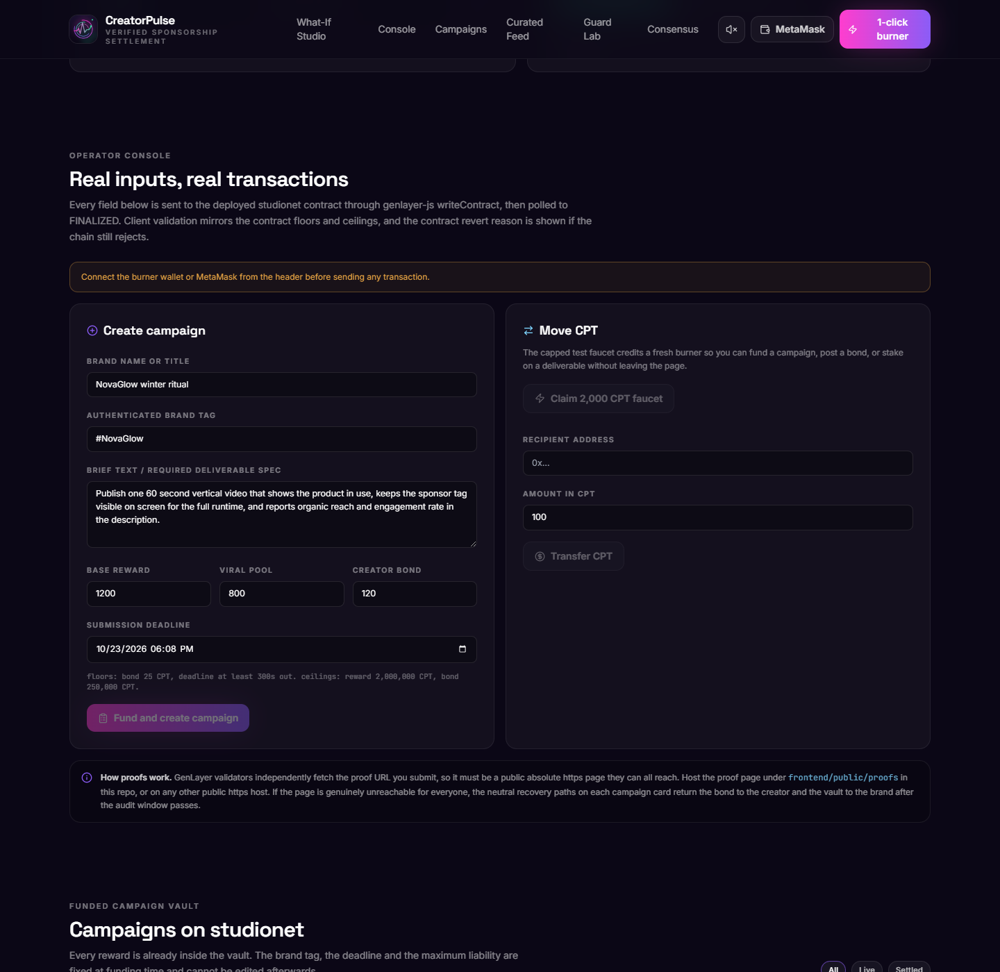
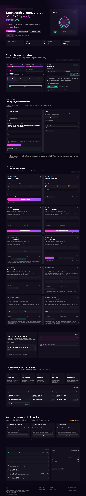
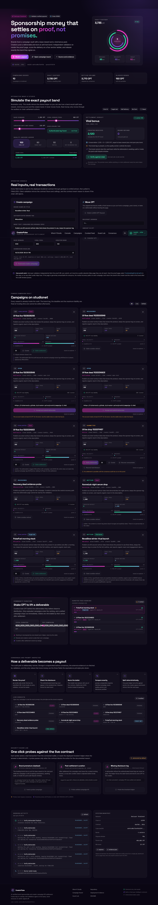
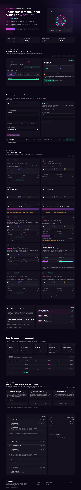
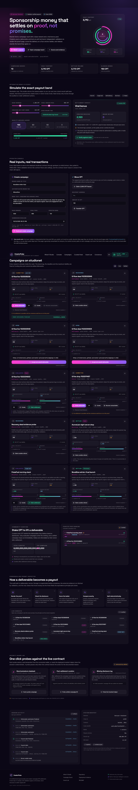

# CreatorPulse

**AI verified brand sponsorship and creator campaign KPI settlement on GenLayer.**

CreatorPulse is a working settlement hub for the creator economy. A brand funds a campaign vault in
CPT, the campaign token. A creator accepts the brief, locks an anti-bot bond, and publishes a
deliverable. Independent GenLayer validators re-render the submitted proof page, verify that the
authenticated brand tag is really disclosed, score the delivery on a four anchor ladder, and agree
exactly on one settlement band. The vault then pays out through a single deterministic helper.

No owner key can score a campaign. No brand can unilaterally approve a payout, slash a creator, or
claw back the viral bonus pool while an audit is pending. The only path from a submitted deliverable
to a payout is live validator consensus. The only other exit from a submitted campaign is a neutral
recovery that returns every token to the party who already owns it, and it can never pay a bonus or
slash a bond, so a brand cannot use it to escape an audit it is about to lose.

- Live app: https://richeroveis.github.io/creator-pulse/
- Repository: https://github.com/richeroveis/creator-pulse
- Contract: `contracts/creator_pulse.py`
- Evidence: `evidence/studionet_deployment.json`
- Tag: `studionet-v2`

---

## Why this exists

Creator sponsorships break down over three questions:

1. Did the creator actually deliver what the brief promised?
2. Was the sponsor disclosure really shown, or only claimed in a caption?
3. Is the engagement organic, or bought?

Today those questions are answered in a private spreadsheet by whoever holds the invoice. Creators
wait months for a discretionary decision. Brands overpay for bot traffic. Affiliate managers have no
auditable record.

CreatorPulse turns the decision into a consensus object. Validators fetch the same public proof page,
run the same ladder, and must agree on three fields before a single CPT leaves custody. The payout
band is derived from those fields by one shared pure function, so a validator cannot "agree" on an
anchor and still have the contract pay a different amount.

---

## The steward red lines

### 1. Zero owner, admin or brand bypasses

There is no `owner`, `admin`, `governor` or `operator` storage field, and no public method that can
set a score, approve a payout or slash a creator. A campaign can only be evaluated through
`verify_campaign_deliverable_live`, which runs `gl.nondet.web.render` and
`gl.eq_principle.prompt_comparative`. The test suite parses the contract AST and fails if any such
role or method ever appears.

### 2. A really funded vault, a creator bond and a maximum liability lock

- CPT lives in `token_balances: TreeMap[Address, u256]` and `vault_custody_balance: u256`.
- `create_campaign` debits `base_reward + viral_bonus_pool` from the brand and locks it. That sum is
  the maximum potential liability of the campaign.
- `accept_and_submit_deliverable` debits `required_creator_bond` from the creator into custody.
- `curate_deliverable` locks community CPT behind a deliverable.
- **PAPITO lock:** the brand cannot withdraw the base reward or the viral pool while the campaign is
  still accepting submissions, while a deliverable is awaiting audit, or during the post-audit
  dispute window. `withdraw_campaign_liquidity` is the only reclaim path and it reverts with
  `PAPITO_LIABILITY_LOCK` in all three states.

### 3. A discrete band decided inside consensus

`verify_campaign_deliverable_live` snapshots every settlement input into plain locals before the non
deterministic call. Inside consensus it renders the proof page, rejects a missing authenticated tag,
and asks the model for exactly one of four anchors. Parsing is fail-closed: malformed JSON, a missing
anchor, a non numeric anchor or an out of range anchor reverts the transaction instead of picking a
friendly default. `prompt_comparative` requires exact agreement on `campaign_band`, `quality_anchor`
and `disclosure_verified`.

### 4. One coherent invariant helper

`_compute_campaign_band` is the single source of truth for every split. The auditor, the settlement
gate and the simulator preview view all call it. `_sync_top_curated_campaign` is the single source of
truth for the curated ranking, and settlement re-syncs it so a settled campaign can never stay on the
board. Settlement requires `evaluated == True` and a closed dispute window.

### 5. A neutral escape when an audit can never complete

A submitted campaign can only strand funds if its proof page becomes permanently unreadable. Two
permissionless recovery paths handle that, both decided by one shared deterministic helper
`_execute_neutral_recovery` that is neutral by construction (creator gets the bond back, brand gets
base plus viral pool back, curators pull their stakes, no bonus, no slash):

1. `recover_unreachable_deliverable` runs `gl.eq_principle.prompt_comparative` on a fetch probe. All
   validators must agree on exactly one boolean, `proof_unreachable`. If the page renders readable
   text the call reverts and the audit remains the only way forward, so this can never be used to
   dodge a winnable audit. It is available only inside a floored window since submission.
2. `recover_hard_timeout` is a much longer backstop for the case where validators cannot agree on
   the fetch at all. It requires that the campaign was never evaluated.

Both move every campaign into the new terminal status `RECOVERED`, after which the audit, curation,
settlement and brand reclaim all revert. Curator refunds stay pull based through
`claim_curation_refund`, so one unreachable curator address can never block a recovery.

---

## Settlement bands

Let `B` be the base reward, `V` the viral bonus pool and `D` the creator bond. The vault always holds
`B + V` after funding and `B + V + D` after submission.

| Band | Trigger | Creator receives | Brand receives |
| --- | --- | --- | --- |
| `VIRAL_BONUS_TIER` | anchor 100 and disclosure verified | `B + V + D` | `0` |
| `TARGET_MET_TIER` | anchor 80 and disclosure verified | `B + D` | `V` |
| `PARTIAL_DELIVERY_TIER` | anchor 50 and disclosure verified | `floor(B/2) + D` | `B - floor(B/2) + V` |
| `BOT_FRAUD_OR_MISSING_DISCLOSURE_SLASH` | anchor 0 or disclosure missing | `0` | `B + V + D` |

Every row satisfies `creator_payout + brand_refund = B + V + D`, which is asserted in the contract,
in the direct tests, and in the live deployment evidence.

Anchors are snapped **down** to the nearest rung. A model answer of 79 becomes 50, never 80. A missing
tag forces anchor 0 regardless of what the model said.

---

## Contract surface

| Method | Type | Purpose |
| --- | --- | --- |
| `faucet_or_deposit(amount)` | write | Capped test faucet, 400,000 CPT lifetime per account |
| `transfer_tokens(to, amount)` | write | CPT transfer with `str` or `Address` coercion |
| `create_campaign(...)` | write | Fund a vault and lock the maximum liability |
| `accept_and_submit_deliverable(id, url)` | write | Lock the creator bond and submit a proof URL |
| `curate_deliverable(id, stake)` | write | Stake CPT behind a submitted deliverable |
| `verify_campaign_deliverable_live(id)` | write | Consensus audit, band and split |
| `claim_campaign_settlement(id)` | write | Release the band after the dispute window |
| `claim_curation_refund(id)` | write | Curator pull refund after settlement or recovery |
| `withdraw_campaign_liquidity(id)` | write | Brand reclaim, blocked by the PAPITO lock |
| `recover_unreachable_deliverable(id)` | write | Neutral recovery when validators agree the page is dead |
| `recover_hard_timeout(id)` | write | Neutral recovery after the long hard timeout window |
| `get_dashboard(limit)` | view | Stats, campaigns, feed and config in one call |
| `get_campaign(id)` | view | Full campaign snapshot |
| `get_feed(limit)` | view | Curated ranking of evaluated campaigns |
| `get_campaign_band_preview(...)` | view | The shared helper, exposed for the simulator |
| `check_vault_invariants()` | view | Vault equals escrow plus unrefunded curation |
| `get_config()` | view | Guardrail constants and the equivalence principle |
| `get_stats()` | view | Vault, volume, slashes, audits |

Other views: `get_campaign_count`, `get_token_balance`, `get_my_balance`, `get_curator_stake`.

---

## Invariants

- `vault_custody_balance == sum(active campaign escrow) + sum(unrefunded curation stakes)`
- `creator_payout + brand_refund == base_reward + viral_bonus_pool + required_creator_bond`
- A settled, cancelled or recovered campaign contributes zero escrow; its curation stake is counted
  as unrefunded until each curator pulls it, then it contributes zero there too
- A campaign cannot be audited twice, settled twice, recovered twice, or curated after settlement or
  recovery
- A brand cannot submit its own campaign, and neither brand nor creator can curate it
- The faucet is capped per account, rewards, bonds and curation stakes all have floors and ceilings, and
  every deadline has a minimum and maximum window

## Lifecycle and liveness

| State | Allowed action | Caller | Next state | Funds movement |
| --- | --- | --- | --- | --- |
| `OPEN` | `accept_and_submit_deliverable` before the deadline | any account except the brand | `SUBMITTED` | creator bond `D` into custody |
| `OPEN` | `withdraw_campaign_liquidity` at or after the deadline | the funding brand | `CANCELLED` | `B + V` refunded to the brand |
| `SUBMITTED` | `verify_campaign_deliverable_live` | anyone (permissionless keeper) | `EVALUATED` | none, the band is stored |
| `SUBMITTED` or `EVALUATED` | `curate_deliverable` before settlement | any account except brand and creator | unchanged | stake `S` into custody |
| `EVALUATED` | `claim_campaign_settlement` after the dispute unlock | anyone (permissionless keeper) | `SETTLED` | `creator_payout + brand_refund` released |
| `SETTLED` | `claim_curation_refund` | the curator that staked | `SETTLED` | `S` returned to that curator |
| `SUBMITTED` | `recover_unreachable_deliverable` when validators agree the page is dead | anyone (permissionless keeper) | `RECOVERED` | neutral return, no bonus, no slash |
| `SUBMITTED` | `recover_hard_timeout` after the long window, never evaluated | anyone (permissionless keeper) | `RECOVERED` | neutral return, no bonus, no slash |
| `RECOVERED` | `claim_curation_refund` | the curator that staked | `RECOVERED` | `S` returned to that curator |

No state can strand funds. An abandoned `OPEN` campaign returns to the brand after the deadline, a
`SUBMITTED` campaign can be audited by anyone, an `EVALUATED` campaign can be claimed by anyone once
the dispute window closes, and a `SUBMITTED` campaign whose proof page can never be read falls back
to one of the two neutral recovery paths. Once `RECOVERED`, every curator still pulls their own
stake back. Settlement and cancellation are mutually exclusive by status and by strictly complementary
timestamp comparisons: submissions require `now < deadline`, reclaim requires `now >= deadline`, and
claims require `now >= unlock`. Recovery is only reachable from `SUBMITTED`, so a brand can never use
it to escape an audit that is about to pay a creator.

---

## Architecture

```text
Brand wallet                       Creator wallet                  Curator wallets
     |                                  |                               |
     | create_campaign                  | accept_and_submit             | curate_deliverable
     v                                  v                               v
+--------------------------------------------------------------------------------------+
|                           CreatorPulse intelligent contract                          |
|                                                                                      |
|  token_balances: TreeMap[Address, u256]        vault_custody_balance: u256          |
|  campaigns: TreeMap[str, Campaign]             curation_stakes: TreeMap[str, u256]  |
|                                                                                      |
|  verify_campaign_deliverable_live                                                    |
|    1. snapshot storage into plain locals                                             |
|    2. gl.nondet.web.render(proof_url, mode="text")                                   |
|    3. require the authenticated brand tag                                            |
|    4. gl.nondet.exec_prompt(json) -> one of 0, 50, 80, 100                           |
|    5. gl.eq_principle.prompt_comparative on band, anchor, disclosure                 |
|    6. _compute_campaign_band -> creator payout, brand refund                         |
|                                                                                      |
|  claim_campaign_settlement -> credit creator and brand, release escrow               |
+--------------------------------------------------------------------------------------+
                                  |
                                  v
                    studionet validators (5 per transaction)
```

The frontend is a React bundle that drives the real contract. It reads state with `get_dashboard`, and
it sends real state changing transactions through genlayer-js `writeContract` for every lifecycle and
recovery method, then polls each transaction to `FINALIZED`. It never computes a settlement locally to
move funds. The What-If Studio mirrors the helper for illustration only, and its "Verify against chain"
button reads `get_campaign_band_preview` from the deployed contract to prove the mirror agrees.

---

## Repository layout

```text
contracts/creator_pulse.py          intelligent contract, pinned runner on line 1
tests/conftest.py                   Windows unlink workaround plus fixtures
tests/test_creator_pulse_direct.py  138 direct tests, all passing
scripts/deploy_studionet.py         idempotent live deployment and seeding
scripts/verify_explorer.py          re-read every transaction through the explorer API
scripts/record_provenance.py        pin the commit that contains the deployed bytes
scripts/verify_identity.py          4-way sha256, address, provenance and explorer check
scripts/write_evidence_md.py        render docs/evidence.md from the evidence JSON
scripts/ci_seed_genvm.py            pin the direct test runner tarball used by CI
scripts/check_frontend_bindings.py  fail if a contract write method has no frontend binding
scripts/test_retry_race.ts          proves the transaction layer never resubmits after a client error
scripts/verify_ui_flow.py           re-read every browser signed hash through the explorer API
tools/drive_ui_flow.py              drive the real UI with Playwright burner wallets and webm capture
tools/drive_verify_claim.py         lean UI pass that clicks Verify then Claim settlement
tools/build_demo_video.py           stitch the webm recordings into a libx264 mp4
tools/read_ui_flow_final.py         independent contract reads confirming the UI outcomes
tools/make_logo.py                  procedural 512x512 logo generator
tools/generate_soundtrack.py        synthesized demo soundtrack
tools/make_demo_video.py            legacy PIL rendered video (superseded by build_demo_video.py)
tools/capture_screenshots.py        screenshot the live deployed page
frontend/                           React, TypeScript, Vite, Tailwind, genlayer-js
frontend/public/proofs/             static proof pages fetched by validators
evidence/studionet_deployment.json  deploy address, tx table, state and hashes
evidence/explorer_verification.json explorer re-check of every recorded transaction
evidence/ui_flow_verification.json  every browser signed tx, its explorer report and contract reads
docs/                               logo, screenshots, evidence notes, demo video (tracked)
.github/workflows/ci.yml            lint, direct tests, identity, bindings, frontend build, retry guard
```

---

## Quick start

```bash
python3 -m venv .venv
. .venv/bin/activate
pip install -r requirements.txt

genvm-lint check contracts/creator_pulse.py
pytest tests/ -q

cd frontend
npm install
npm run build
npm run dev
```

Live deployment (needs `GENLAYER_PRIVATE_KEY` in this project's own `.env`):

```bash
.venv/bin/python scripts/deploy_studionet.py            # deploys, seeds, audits, settles
.venv/bin/python scripts/verify_explorer.py             # independent explorer re-check
.venv/bin/python scripts/record_provenance.py           # pin the deployed source commit
.venv/bin/python scripts/write_evidence_md.py           # regenerate docs/evidence.md
.venv/bin/python scripts/verify_identity.py             # 4-way hash, address, provenance
```

The deploy script checkpoints every step in `evidence/_deploy_state.json` (gitignored) so a network
failure resumes instead of duplicating transactions. Burner keys for the demo brands, creators and
curators live only in that ignored file. `--fresh` forces a new deployment, and the deployment
refuses to write evidence unless the deployed contract file is committed.

---

## Live studionet evidence

<!-- DEPLOYMENT_EVIDENCE_START -->
### Deployment identity

| Field | Value |
| --- | --- |
| Network | studionet, chain id 61999 |
| Contract | [`0x6768EAdcFBF13aDEE460Bfd228f6653f3e013016`](https://explorer-studio.genlayer.com/address/0x6768EAdcFBF13aDEE460Bfd228f6653f3e013016) |
| Deploy transaction | [`0x48e6029a946a6b87b33c9e5a90423c8e277d7a6cd303edfc66f1ee91afe4b065`](https://explorer-studio.genlayer.com/tx/0x48e6029a946a6b87b33c9e5a90423c8e277d7a6cd303edfc66f1ee91afe4b065) |
| Source commit | `a77042e409dacf6e205839a31c610e3d48a35fe5` (tag `untagged`) |
| Contract file sha256 | `ed4fcc08c72e4926329f9efc6c3a16ac7d0b6d57ef04abd03136d1d6ea0381aa` |
| Runner | `# { "Depends": "py-genlayer:1jb45aa8ynh2a9c9xn3b7qqh8sm5q93hwfp7jqmwsfhh8jpz09h6" }` |

The source commit is resolved by hashing the contract blob at every commit that touched
`contracts/creator_pulse.py` and keeping the newest one whose digest equals the deployed file, so
`git show a77042e409dacf6e205839a31c610e3d48a35fe5:contracts/creator_pulse.py` reproduces the row above.

Four independent places carry the same code hash: `contracts/creator_pulse.py` on disk,
`evidence/studionet_deployment.json`, `frontend/src/config.ts` and this README. Run
`python scripts/verify_identity.py` to re-check all four, the address in the evidence file and the
frontend, and the source commit provenance.

### Transaction table

studionet does not publish deployed Python source: the explorer has no source field and
`eth_getCode` returns `0x` for this address. Identity therefore rests on the deploy transaction, the
source commit and the file digest above. Every row below was polled to `FINALIZED` over the RPC while
the scenario ran, then re-read independently through the explorer JSON API by
`python scripts/verify_explorer.py`, which also checks the validator votes and the exact revert
payload of each guard probe. Guard probes are expected to finish with `FINISHED_WITH_ERROR`.

Explorer re-verification: 39/39 rows PASS, checked 2026-10-22T17:24:01Z.

| Step | Transaction | Status | Result | Execution | Votes |
| --- | --- | --- | --- | --- | --- |
| `deploy` | [0x48e6029a94](https://explorer-studio.genlayer.com/tx/0x48e6029a946a6b87b33c9e5a90423c8e277d7a6cd303edfc66f1ee91afe4b065) | FINALIZED | MAJORITY_AGREE | SUCCESS | 3 agree / 0 disagree |
| `faucet:brand_nova` | [0x326374cfdb](https://explorer-studio.genlayer.com/tx/0x326374cfdb0fcf852e62395bb16f708601ff7c8c0ff590350d31b13f837c36e6) | FINALIZED | MAJORITY_AGREE | SUCCESS | 3 agree / 0 disagree |
| `faucet:brand_pulse` | [0x3637e03697](https://explorer-studio.genlayer.com/tx/0x3637e03697876d38b320a359e44947839cb7104ef91a68c336ba1848db4d1c35) | FINALIZED | MAJORITY_AGREE | SUCCESS | 3 agree / 0 disagree |
| `faucet:brand_aurora` | [0xd21d2bc2c1](https://explorer-studio.genlayer.com/tx/0xd21d2bc2c15323fc1dcd8d6e89411e01cd95b53047991bdcb83ba0521f488915) | FINALIZED | MAJORITY_AGREE | SUCCESS | 3 agree / 0 disagree |
| `faucet:creator_mira` | [0xe0a003f328](https://explorer-studio.genlayer.com/tx/0xe0a003f328bfda5374775177b36b6ed3e2005278424611b7d6574e9f7e14ac60) | FINALIZED | MAJORITY_AGREE | SUCCESS | 3 agree / 0 disagree |
| `faucet:creator_jonas` | [0x75ec0ac006](https://explorer-studio.genlayer.com/tx/0x75ec0ac00617471318c049c12c03ff4530e96ecd5db29d3a4bbd69c3e3ecd943) | FINALIZED | MAJORITY_AGREE | SUCCESS | 3 agree / 0 disagree |
| `faucet:curator_lin` | [0x9fbee46fab](https://explorer-studio.genlayer.com/tx/0x9fbee46fab4b45d197b7bc91706f0f85b19c9a765f4bfb4a66eb4f32a726c943) | FINALIZED | MAJORITY_AGREE | SUCCESS | 3 agree / 0 disagree |
| `faucet:curator_ada` | [0xee88fb65db](https://explorer-studio.genlayer.com/tx/0xee88fb65dbc59225eebdf270a491025cc596f2b53eb4f56c0aade87a2c516c3b) | FINALIZED | MAJORITY_AGREE | SUCCESS | 3 agree / 0 disagree |
| `create:1` | [0x5fdb02075c](https://explorer-studio.genlayer.com/tx/0x5fdb02075c8615a36e3e6113fdacb090a3e3d7200f1f44006650e18a49b11a2a) | FINALIZED | MAJORITY_AGREE | SUCCESS | 3 agree / 0 disagree |
| `create:2` | [0xa96a8d252b](https://explorer-studio.genlayer.com/tx/0xa96a8d252b4cb80b66c458e591c1d4f81042ab43045a5c0d163e7dcc3c5e2b12) | FINALIZED | MAJORITY_AGREE | SUCCESS | 3 agree / 0 disagree |
| `create:3` | [0xaf88a9f1bd](https://explorer-studio.genlayer.com/tx/0xaf88a9f1bdb73ea256bb4a35844f24b79f6f8d56b35c517552ff3b621e43070a) | FINALIZED | MAJORITY_AGREE | SUCCESS | 3 agree / 0 disagree |
| `create:4` | [0xeb729541d7](https://explorer-studio.genlayer.com/tx/0xeb729541d7bc5af99eff734ffe0e279e13f82ea86bec5886e10955426b2f3f14) | FINALIZED | MAJORITY_AGREE | SUCCESS | 3 agree / 0 disagree |
| `submit:1` | [0x761e6f085d](https://explorer-studio.genlayer.com/tx/0x761e6f085d8bfa83c68a995faf1894d40f01bc2321d81bd6270565da786d8917) | FINALIZED | MAJORITY_AGREE | SUCCESS | 3 agree / 0 disagree |
| `submit:2` | [0x2cfeafdd60](https://explorer-studio.genlayer.com/tx/0x2cfeafdd60287ec0726a84d0946abcbe6d8bb76baa083291623eaff4bdfb0d0e) | FINALIZED | MAJORITY_AGREE | SUCCESS | 3 agree / 0 disagree |
| `submit:3` | [0x12a985a35e](https://explorer-studio.genlayer.com/tx/0x12a985a35e9f6908015ddc08eafe2aa7159d91f662035e0aa1dc96bfc593042e) | FINALIZED | MAJORITY_AGREE | FINISHED_WITH_ERROR | 3 agree / 0 disagree |
| `submit:4` | [0x04bdb110e0](https://explorer-studio.genlayer.com/tx/0x04bdb110e0cd3e3fc1125c79885c1c0de4a1a89c991cc7b5ad7eaf5074e61040) | FINALIZED | MAJORITY_AGREE | SUCCESS | 4 agree / 0 disagree |
| `guard:recover-before-window` | [0x0196dbd196](https://explorer-studio.genlayer.com/tx/0x0196dbd196ad5bd88113ae3905a3839e7af2327a22f9f56c588cf55998716fac) | FINALIZED | MAJORITY_AGREE | FINISHED_WITH_ERROR | 3 agree / 0 disagree |
| `guard:recover-hard-timeout-early` | [0xb208aafcd8](https://explorer-studio.genlayer.com/tx/0xb208aafcd88d0799e7f2cb9438643acd53136a95031beef6f771eff29429b6aa) | FINALIZED | MAJORITY_AGREE | FINISHED_WITH_ERROR | 3 agree / 0 disagree |
| `curate:1` | [0x5140b487ce](https://explorer-studio.genlayer.com/tx/0x5140b487ce73d0b4e7e9f6bb78c26bee329a08924a757a912fc3309ac426748a) | FINALIZED | MAJORITY_AGREE | SUCCESS | 3 agree / 0 disagree |
| `curate:2` | [0xb8c3f6160d](https://explorer-studio.genlayer.com/tx/0xb8c3f6160db190a71d024151b9180b5b69f318f4da18411e3f75d0ccedf39bf9) | FINALIZED | MAJORITY_AGREE | SUCCESS | 3 agree / 0 disagree |
| `curate:3` | [0x32f793c59e](https://explorer-studio.genlayer.com/tx/0x32f793c59e6ef774cbaa69f3cdd214d7531180000d38e1875063f7e6edd1393d) | FINALIZED | MAJORITY_AGREE | SUCCESS | 4 agree / 0 disagree |
| `curate:4` | [0xd7128272ae](https://explorer-studio.genlayer.com/tx/0xd7128272aef68c80b875090061a75256954c1dc8069b44af4a129bee4c8b9144) | FINALIZED | MAJORITY_AGREE | SUCCESS | 4 agree / 0 disagree |
| `curate:recovery` | [0xb28000cf66](https://explorer-studio.genlayer.com/tx/0xb28000cf66b2a9669af6b3002295fcd8e9a7570abd2b2066d05cb933dc311b2f) | FINALIZED | MAJORITY_AGREE | SUCCESS | 3 agree / 0 disagree |
| `guard:clawback-submitted` | [0x90f21929e1](https://explorer-studio.genlayer.com/tx/0x90f21929e125169d913d38b7fccbc6bfcfb3625a9b302b318aceff5c52f5ea1b) | FINALIZED | MAJORITY_AGREE | FINISHED_WITH_ERROR | 4 agree / 0 disagree |
| `audit:1` | [0x306c84fa7d](https://explorer-studio.genlayer.com/tx/0x306c84fa7dab1f0a5695362c43bce3cf367dd551213640645650ffb7e50b4071) | FINALIZED | MAJORITY_AGREE | SUCCESS | 3 agree / 1 disagree |
| `audit:2` | [0x2d2a0b31ac](https://explorer-studio.genlayer.com/tx/0x2d2a0b31ac308c3c18a8ad4f144241a1d493465091fb1bdee3d27795b9575068) | FINALIZED | MAJORITY_AGREE | SUCCESS | 3 agree / 0 disagree |
| `audit:3` | [0x7d36ba26d3](https://explorer-studio.genlayer.com/tx/0x7d36ba26d36468e212d33058d5d6ab8d96c5c1cea30fce5aa324aef0c4039cd6) | FINALIZED | MAJORITY_AGREE | SUCCESS | 3 agree / 0 disagree |
| `guard:clawback-evaluated` | [0x1681d33925](https://explorer-studio.genlayer.com/tx/0x1681d33925b401056ab341c54b7dce4aa5b5b90a9bc4949d0693d07dcd51d379) | FINALIZED | MAJORITY_AGREE | FINISHED_WITH_ERROR | 3 agree / 0 disagree |
| `settle:1` | [0x3a3356d6ed](https://explorer-studio.genlayer.com/tx/0x3a3356d6ed649de420b9aa096f158a5db46990e0190ecff6c5e7a609e5b78c0e) | FINALIZED | MAJORITY_AGREE | SUCCESS | 3 agree / 0 disagree |
| `settle:3` | [0x3ef791549e](https://explorer-studio.genlayer.com/tx/0x3ef791549ee85eed6d1403157277ae19769291ecf088d422911d90b895d7189f) | FINALIZED | MAJORITY_AGREE | SUCCESS | 3 agree / 0 disagree |
| `refund:curation-1` | [0x913322750f](https://explorer-studio.genlayer.com/tx/0x913322750f6780102e27a4092f80eccd39a5c3c2672ebfa2e0746eb11e45f8dd) | FINALIZED | MAJORITY_AGREE | SUCCESS | 3 agree / 0 disagree |
| `guard:curate-after-settlement` | [0x2e881f8589](https://explorer-studio.genlayer.com/tx/0x2e881f8589420adfd7d30b26d9b164e9cbc553593182fd44a2da9abc8a895c39) | FINALIZED | MAJORITY_AGREE | FINISHED_WITH_ERROR | 3 agree / 0 disagree |
| `guard:transfer-overdraw` | [0xa19ea7a585](https://explorer-studio.genlayer.com/tx/0xa19ea7a585c194dda5e9a417e6d6a0c9da5351fbd8e10a31cff99c2aa09ba68d) | FINALIZED | MAJORITY_AGREE | FINISHED_WITH_ERROR | 3 agree / 0 disagree |
| `recover:4` | [0x75930721a3](https://explorer-studio.genlayer.com/tx/0x75930721a3307981dcfbabc185cc86f09b1405e6e4489d93044cac2ec50043a7) | FINALIZED | MAJORITY_AGREE | SUCCESS | 3 agree / 0 disagree |
| `guard:audit-after-recovery` | [0xb29ea19976](https://explorer-studio.genlayer.com/tx/0xb29ea1997665908c9d129e17a7bf26ffbd23ae2c90f74f8605c1293ff109fe63) | FINALIZED | MAJORITY_AGREE | FINISHED_WITH_ERROR | 3 agree / 0 disagree |
| `guard:curate-after-recovery` | [0x7ffdb4e8b0](https://explorer-studio.genlayer.com/tx/0x7ffdb4e8b05f21c6ba50b8350657110759acbd1142affeec4c84a75a99a544ac) | FINALIZED | MAJORITY_AGREE | FINISHED_WITH_ERROR | 3 agree / 0 disagree |
| `guard:withdraw-after-recovery` | [0x86a4a556d5](https://explorer-studio.genlayer.com/tx/0x86a4a556d5e59003982997f7a3413b750210e62a735da0458aedcad86ad4c316) | FINALIZED | MAJORITY_AGREE | FINISHED_WITH_ERROR | 4 agree / 0 disagree |
| `guard:recover-twice` | [0x7bc1786d78](https://explorer-studio.genlayer.com/tx/0x7bc1786d78f5a066cc8d4fe5c9d02b2959e1743cc62ec9af03601c3e2710a21e) | FINALIZED | MAJORITY_AGREE | FINISHED_WITH_ERROR | 5 agree / 0 disagree |
| `refund:recovery-curator` | [0x971babf170](https://explorer-studio.genlayer.com/tx/0x971babf1705a1961f8b74337e2bd8c438240fede7dea54b9666b460c104b3b4b) | FINALIZED | MAJORITY_AGREE | SUCCESS | 3 agree / 0 disagree |

### Final campaign state

| Id | Campaign | Band | Anchor | Creator CPT | Brand CPT | State |
| --- | --- | --- | --- | --- | --- | --- |
| 4 | Recovery dead evidence probe | `` | 0 | 0 | 0 | RECOVERED |
| 3 | AuroraLab night serum drop | `BOT_FRAUD_OR_MISSING_DISCLOSURE_SLASH` | 0 | 0 | 1650 | SETTLED |
| 2 | PulseFuel morning stack | `TARGET_MET_TIER` | 80 | 1000 | 400 | EVALUATED |
| 1 | NovaGlow winter ritual launch | `VIRAL_BONUS_TIER` | 100 | 2120 | 0 | SETTLED |

Vault invariant at the end of the run:
`vault 1610 CPT == escrow
1400 + curation
210`, drift
`0`.

The raw machine readable record, including every vote tally, payload and final balance, lives in
[`evidence/studionet_deployment.json`](evidence/studionet_deployment.json), and the explorer
re-check lives in [`evidence/explorer_verification.json`](evidence/explorer_verification.json).

<!-- DEPLOYMENT_EVIDENCE_END -->

---

## Security model

| Threat | Control |
| --- | --- |
| Brand tries to score or approve its own campaign | No privileged write path exists; scoring only through consensus |
| Brand pulls the viral pool during an audit | `PAPITO_LIABILITY_LOCK` revert in open, submitted and post-audit states |
| Creator fakes the disclosure in a caption | The tag must appear in the rendered page text, checked deterministically |
| Creator buys engagement | Anchor 0 or a bot signal forces the slash band and burns the bond |
| Model returns malformed JSON to force a payout | Fail-closed parsing reverts instead of defaulting |
| Prompt injection inside the proof page | Content is sanitized and delimited, the disclosure gate is deterministic and sits outside the model, and every validator re-runs the audit |
| Leader picks a self-serving band | `prompt_comparative` demands exact agreement on three settlement fields |
| Validator reads different state | All inputs are snapshotted before the non deterministic call |
| Settlement pays more than custody | Conservation is asserted before any credit and checked by a view |
| Curator games the feed after settlement | Curation reverts once settled, and settlement re-syncs the ranking |
| Replay of a claim | `settled` flag plus state machine block a second release |
| Brand self-dealing | Brand cannot submit its own campaign, neither party can curate it |

---

## Known limits

- The faucet mints test CPT per account, so any number of wallets can obtain balances. CPT has no
  monetary value and this contract is a studionet deployment.
- Curation is one wallet one stake: a brand can still use a second wallet to stake on its own campaign.
  The curated feed is a discovery signal, it never changes a payout.
- Audit liveness depends on the validator set agreeing on the external fetch. Every audit is
  permissionless and retryable. There is no discretionary timeout refund a brand could use to escape
  an audit it is about to lose; the escape hatches are strictly neutral.
- Dead evidence is now handled, not stranded. If a submitted proof page becomes permanently
  unreadable, `recover_unreachable_deliverable` lets validators agree on one boolean and run a neutral
  recovery after the minimum window, and `recover_hard_timeout` is a longer backstop for when
  validators cannot agree on the fetch at all. Both return the bond to the creator, the vault to the
  brand and every stake to its curator, pay no bonus and slash nothing. The remaining trust
  assumption is honest validator behaviour on the fetch: recovery only succeeds when a majority
  genuinely agrees the page is unreachable, and a readable page always reverts the recovery so the
  audit stays the only path to a payout.
- The unreachable floor is a security parameter, not the main guarantee. Because the audit is
  permissionless from the moment of submission, the real anti escape protection is that path a
  requires unanimous agreement that the page cannot be read. The floor (a few minutes here) only
  stops a recovery from racing a brand new submission or a flaky fetch.
- `check_vault_invariants` and `_resync_top_curated` scan campaigns linearly. That is fine at the campaign
  counts used here. A high volume deployment would maintain running totals in storage instead.
- Direct tests exercise the leader path only. Validator agreement is proven by the live studionet
  audits and the live neutral recovery recorded in `docs/evidence.md`, not by pytest.
- The proof page is creator-authored, so reach and engagement numbers are self-reported. Prompt injection
  is mitigated by sanitization, by the deterministic disclosure gate and by independent validator re-runs,
  but it is not claimed to be impossible. A production extension would replace the self-reported metrics
  with a signed platform analytics feed.

## Frontend













- Creator economy studio aesthetic on midnight `#0B0716` with magenta, violet and emerald rings.
- Operator console with real forms for create campaign, deliverable submission, curation, transfer and
  the capped faucet, each validated client side against the contract floors and ceilings and each sent
  as a real transaction, with the tx hash linked to the explorer and the status polled to `FINALIZED`.
- The transaction layer never resubmits a write after a client side error. A submission is keyed by a
  fingerprint of sender plus function plus arguments; if the receipt poll fails, times out, or the page
  reloads, the known hash is watched again (or resumed from `localStorage`, which stores only the hash
  and campaign id, never any key) instead of sending a second transaction. A failure before any hash is
  known raises an unambiguous error and re-reads contract state rather than blindly retrying.
- Per campaign actions: accept and submit with a real proof URL, verify (the consensus audit), claim
  settlement (only enabled once the audit has run and the dispute window has closed, and the UI says
  so), claim curation refund (after settlement or recovery), withdraw liquidity, and the two neutral
  recovery buttons.
- Interactive What-If payout and viral bonus simulator, clearly labelled illustration only.
- Consensus and prompt inspector drawer: exact prompt, equivalence principle, snapshot, verdict.
- Security Guard Lab: one click real transaction probes plus a deterministic slash probe.
- Dual wallet: a 1-click browser burner with a locally generated key, or MetaMask. The burner path is the
  one exercised by the headless browser runs below; MetaMask mode is not tested in headless runs and is
  therefore described as untested rather than verified.
- Receipt waiting is robust for slow audits: it polls one already submitted hash for up to 60 minutes
  with backoff, prints elapsed time and the hash with an explorer link while it waits, and a page reload
  resumes watching a pending hash. The recovery window buttons read their floor from `get_config`, so
  they can never drift from the deployed contract.
- A proofs note explaining that validators fetch the proof URL and that the creator can host the proof
  page under `frontend/public/proofs` or any public https host.
- Web Audio synthesizer: ambient pad, chord swells and UI cues, generated at runtime.
- One `get_dashboard` call plus one `get_config` call on first paint (a handful of reads, kept low to
  respect the studionet 500 requests per hour limit), one status lookup per poll cycle while a write is
  in flight, and no local ABI override is ever passed to `readContract`.

---

## Demo video

`docs/demo-video-subtitled.mp4` is a real screen recording of the browser driven studionet flow
below, stitched from the per session Playwright webm captures and encoded to h264 with the libx264
encoder bundled in `imageio-ffmpeg` (no system ffmpeg needed). It is 3 minutes 42 seconds at 1280x720,
fast forwarded through the long consensus waits, and it visibly shows the create form with custom
inputs, the deliverable submission with a real proof URL, curation, the Verify (consensus audit) click,
the claim settlement click, and the second campaign whose unreachable proof goes through the neutral
recovery. Rebuild it after a fresh browser run with:

```bash
.venv/bin/python tools/drive_ui_flow.py            # records webm into artifacts/video
.venv/bin/python tools/build_demo_video.py         # stitches and encodes the mp4
```

Video sha256 `4afdd271cef6e8c2f0d1f816a3445b1980d65ddfaa91f3ef2ae9407455a9c2a8`. The finished video is
tracked on `main` and mirrored into `frontend/public`:

- Repository copy: https://github.com/richeroveis/creator-pulse/raw/main/docs/demo-video-subtitled.mp4
- Live copy: https://richeroveis.github.io/creator-pulse/demo-video-subtitled.mp4

## Browser driven UI evidence

`tools/drive_ui_flow.py` and `tools/drive_verify_claim.py` launch a real Chromium, connect burner
wallets in separate browser contexts, and drive the deployed contract purely through the forms, while
`scripts/verify_ui_flow.py` re-reads every browser signed hash through the explorer JSON API. The
result, recorded in `evidence/ui_flow_verification.json`, is 16 of 16 rows `FINALIZED` with validator
majority and no appeal:

- Settlement path from the browser: create campaign (custom inputs), accept and submit a real public
  proof URL, curate, click Verify (`verify_campaign_deliverable_live`) to FINALIZED, wait out the 90
  second dispute window, then click Claim settlement. An independent contract read confirms the campaign
  reached `SETTLED` and the vault invariant still holds with zero drift.
- Recovery path from the browser: a second campaign submitted a genuinely unreachable proof page, then
  the evidence unreachable recovery was triggered from the UI after its window, reaching `RECOVERED`, and
  the curator pulled the stake back with Claim curation refund. A contract read confirms the recovered
  state, the refund and a drift of zero.
- Settlement gating: on a SUBMITTED campaign that has not been audited, Claim settlement is not available
  and the board shows the reason, captured in `docs/screenshot-claim-disabled.png`.

Honest scope: the studionet public RPC enforces 500 requests per hour, which repeatedly stopped a single
continuous multi actor pass, so the settlement path and the recovery path were each completed across more
than one browser session. Every listed step is still a real browser signed transaction that the explorer
confirms `FINALIZED`, not a scripted call. MetaMask mode is not exercised in these headless runs and is
documented as untested rather than verified.

---

## Licence

MIT. Test assets only. CPT has no monetary value.
